=========================
Der neue Metadaten-Editor
=========================

Der neue Metadaten-Editor zur Erfassung von ISO-Metadaten wurde technisch von Grund auf erneuert. Er enthält eine Vielzahl an Verbesserungen. Benutzerfreundlichkeit, Barrierefreiheit, responsives Layout für unterschiedliche Bildschirme sowie Touch-Bedienung für Tablets und Touch-Monitore, wurden berücksichtigt. Eine intuitive Bedienung erleichtert die Eingabe der Daten. Der Editor wurde für den Einsatz im BKG angepasst. 

Metadaten-Editor - Übersicht
---------------------------- 

Nach Start des Editors wird dem Nutzer eine Übersicht der zuletzt bearbeiteten Metadaten angezeigt. 

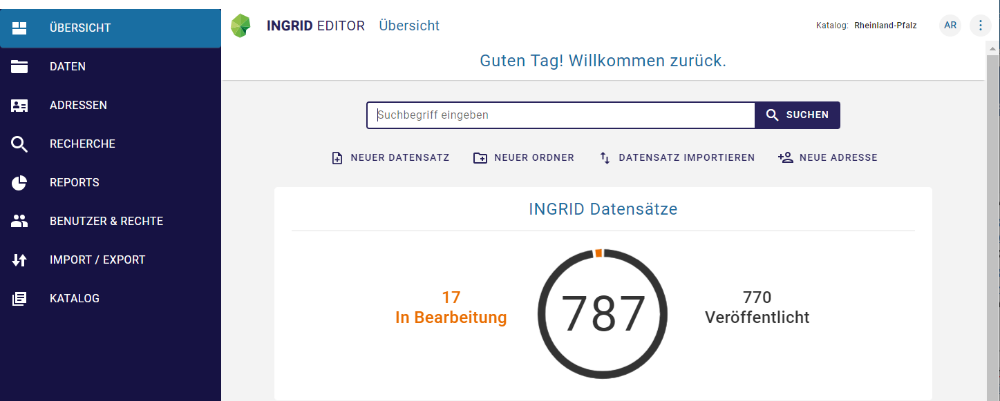
   
Abb.: Übersicht

Aufbau der Benutzeroberfläche
-----------------------------

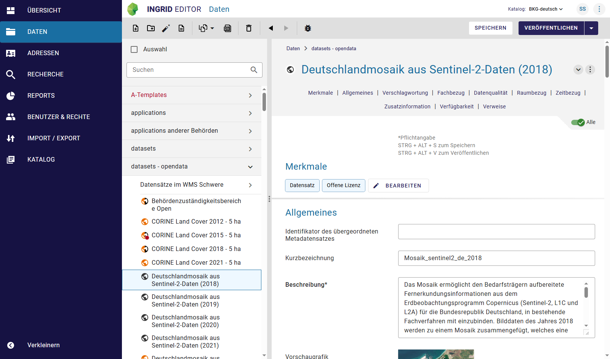
   
Abb.: Editor - Benutzeroberfläche

Aufbau der Benutzeroberfläche:
* linke Seite - Navigation
* oben - Symbolleiste
* mittig - Ordnerstruktur
* rechte Seite - Datenerfassung

Seitenbereich Navigation
^^^^^^^^^^^^^^^^^^^^^^^^

   

Über den Pfeil unten im Navigationsbereich |verkleinern| kann das Menü verkleinert und vergrößert und damit die Größe des Arbeitsbereichs angepasst werden.

Daten
~~~~~

Im BKG erfassen wir ISO-Metadaten lediglich für "Geodatensätze", "Geodatendienste" und "Anwendungen". Daher sind nur diese Objektarten zu verwenden.

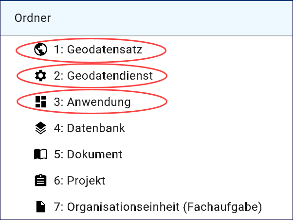

Abb.: Metadatentypen in der Ordnerstruktur

Adressen
~~~~~~~~

Im BKG werden Adressen nur vom Fachadministrator im Editor angelegt. Bitte nehmen Sie bei Bedarf an einer neuer Adresse Kontakt mit dem Fachverfahrensverantwortlichen der Anwendung auf. 
Für die BKG-MD gilt, möglichst keine Personendaten zu veröffentlichen. Es gibt vereinzelt Ausnahmen.

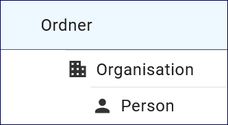

Abb.: Adresstypen in der Ordnerstruktur

Die derzeit verfügbaren Adressen (Stand: März 2025):

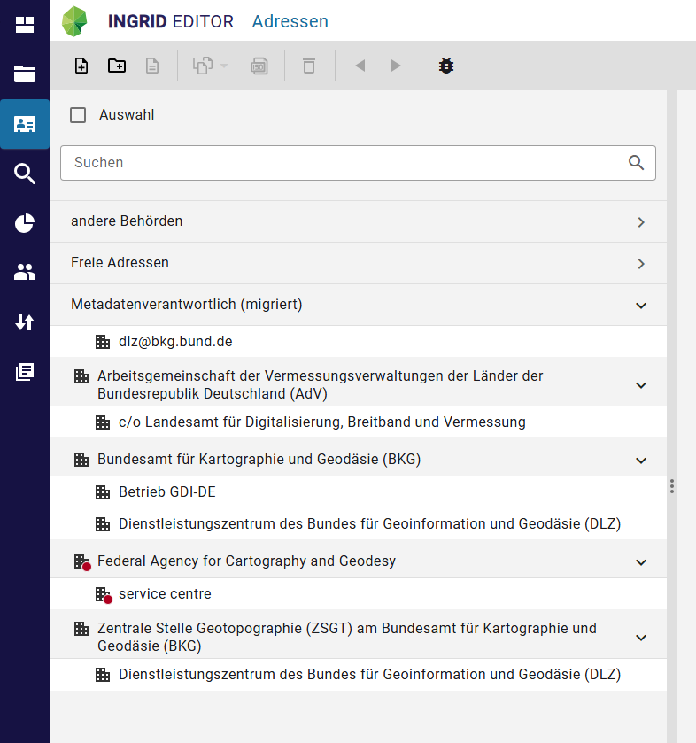

Abb.: verfügbare Adressen im BKG-Editor

Symbole - Bearbeitungsstatus der Daten und Adressen
~~~~~~~~~~~~~~~~~~~~~~~~~~~~~~~~~~~~~~~~~~~~~~~~~~~

Neben den Daten- und Adresstypen zeigen die Icons auch den Bearbeitungsstatus an, um eine bessere Übersicht zu gewährleisten.

.. csv-table::
   :widths: 50, 150, 300

   Symbol , Farbe , Beschreibung
   .. figure:: ../../img/ige/allgemein/icon_bearbeitungsstatus-gespeichert.png , orange , Der Metadatensatz bzw. die Adresse wurde angelegt und gespeichert und befinden sich in Bearbeitung.
	.. figure:: ../../img/ige/allgemein/icon_bearbeitungsstatus-veroeffentlicht.png, schwarz , Der Metadatensatz bzw. die Adresse wurde veröffentlicht
   .. figure:: ../../img/ige/allgemein/icon_bearbeitungsstatus-in-bearbeitung.png , orange und schwarz , Es handelt sich um eine veröffentlichte Version des Metadatensatzes bzw. der Adresse - der Metadatensatz wurde bearbeitet aber noch nicht erneut veröffentlicht.

Symbolleiste
^^^^^^^^^^^^

Die Symbolleiste enthält Funktionen, die sich auf den Seitenbereich Ordnerstruktur und Datenerfassung auswirken.

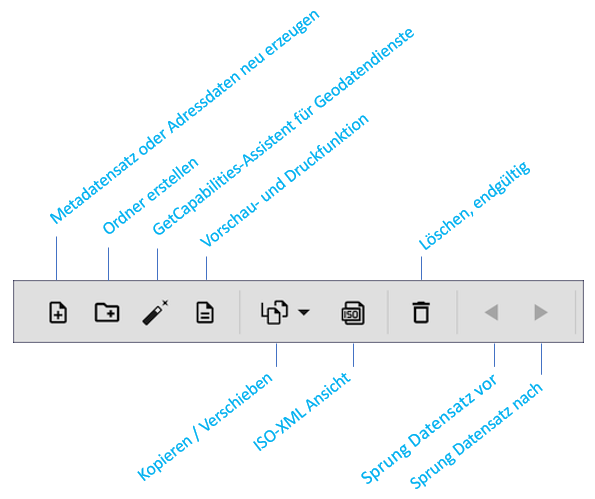
   
Abb.: Symbolleiste

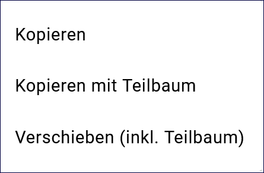

Abb.: Symbolleiste - Untermenü für Kopieren / Verschieben

Seitenbereich Ordnerstruktur der Metadaten
^^^^^^^^^^^^^^^^^^^^^^^^^^^^^^^^^^^^^^^^^^

Im Bereich "Ordnerstruktur" der Benutzeroberfläche kann über Ordner zu den Metadatensätzen navigiert werden. Für den Einsatz des Editors im BKG wurde die Ordnerstruktur vom Fachverfahrensverantwortlichen vorbereitet. Sie ist im Bedarfsfall veränderbar.

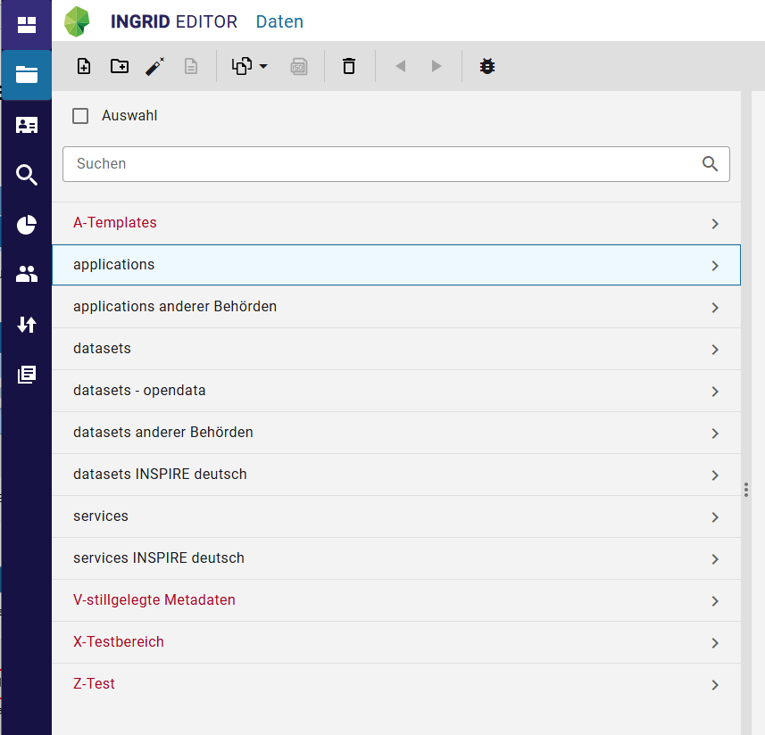
   
Abb.: Editor - Aufbau der Ordnerstruktur im BKG

Seitenbereich Datenerfassung
^^^^^^^^^^^^^^^^^^^^^^^^^^^^

Dieser Bereich gliedert sich in einen Kopfbereich (grau hinterlegt) und der Erfassungsmaske.

Im Kopfbereich sind außer der Anzeige des Titels und Ordnerpfad des angezeigten Datensatzes, hauptsächlich Funktionen zur Navigation in dem Eingabeformular und der Anzeigesteuerung bereitgestellt.

Pfeilsymbol - Kopfbereich vergrößern / verkleinern 
~~~~~~~~~~~~~~~~~~~~~~~~~~~~~~~~~~~~~~~~~~~~~~~~~~

Anzeige Ordnerpfad der Datensätze
~~~~~~~~~~~~~~~~~~~~~~~~~~~~~~~~~

Oberhalb des Titels wird der Ordnerpfad angezeigt, die dem Benutzer vermittelt, in welcher Ordner-Ebene sich der angezeigte Datensatz befindet.

Abb.: Ordnerpfad

Sprungmarken
~~~~~~~~~~~~

Unterhalb des Titels des Datensatzes sind Sprungmarken sichtbar, mit deren Hilfe der Nutzer zu verschiedenen Abschnitten der Erfassungsmaske gelangen kann.

Abb.: Sprungmarken

Drei-Punkt-Menü - Optionen zu den Metadaten 
~~~~~~~~~~~~~~~~~~~~~~~~~~~~~~~~~~~~~~~~~~~

Über das Drei-Punkte-Menü, rechts neben dem Titel, können verschiedene Aktionen angesteuert werden. Nachfolgend die Ansicht für den Administrator:

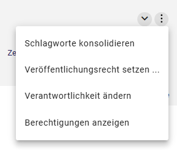

Ein Nutzer in der Rolle "Autor" ist eingeschränkt und kann nur die Funktionen "Schlagworte konsolidieren" und "Veröffentlichungsrecht setzen" verwenden.

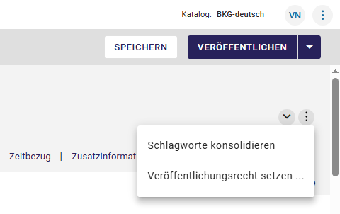

Schlagworte konsolidieren
"""""""""""""""""""""""""

Mit dieser Funktion werden die Thesaurie mit den Schlagworten aus der Freitexteingabe durchsucht und zugeordnet, sofern sie dort registriert sind.

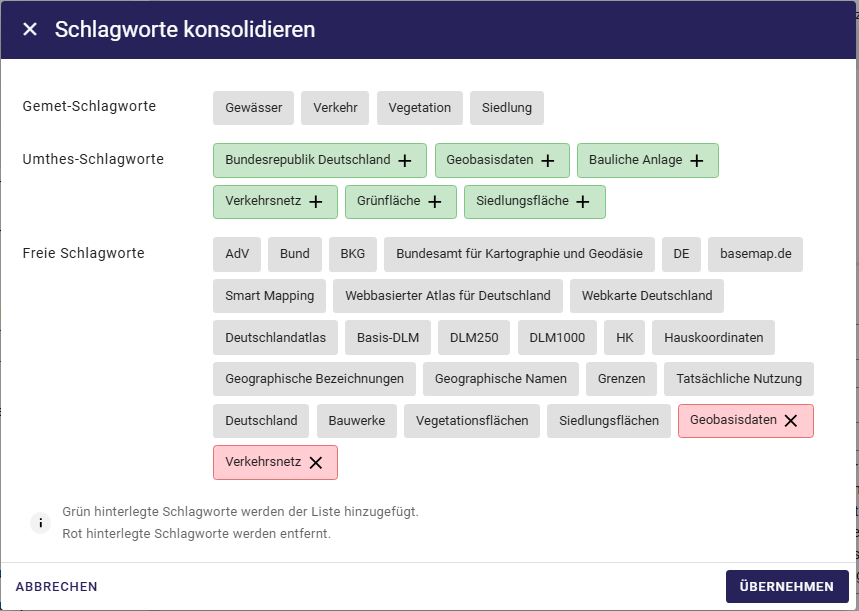

Abb.: Schlagworte abgleichen

Anhand der Symbole in der Ordnerstruktur wird durch einen Punkt das Veröffentlichungsrecht der Adresse oder des Metadatensatzes angezeigt.

Veröffenlichungsrecht setzen
""""""""""""""""""""""""""""

Das Veröffentlichungsrecht ermöglicht die Steuerung wie weit ein Metadatensatz verbreitet werden soll/darf. Im BKG sollte als Veröffentlichungsrecht immer "Internet" gesetzt sein, da die Metadaten des BKG uneingeschränkt öffentlich nutzbar sind. Die Veröffentlichungsebenen "Intranet" und "Amtsintern" sind im BKG nicht eingerichtet. 

Abb.: Veröffentlichungsrechte für Internet, Intranet und amtsintern

Anhand der Symbole in der Ordnerstruktur wird durch einen Punkt das Veröffentlichungsrecht der Adresse oder des Metadatensatzes angezeigt.

.. csv-table::
   :widths: 50, 150, 300

   Symbol , Markierung , Beschreibung
   .. figure:: ../../img/ige/allgemein/icon_veroeffentlichungsrecht-internet.png , ohne Punkt , Der Metadatensatz bzw. die Adresse wird im Internet veröffentlicht
   .. figure:: ../../img/ige/allgemein/icon_veroeffentlichungsrecht-intranet.png, blauer Punkt , Der Metadatensatz bzw. die Adresse wird im Intranet veröffentlicht
   .. figure:: ../../img/ige/allgemein/icon_veroeffentlichungsrecht-amtsintern.png , roter Punkt , Der Metadatensatz bzw. die Adresse ist auf amtsintern gesetzt. Der Datensatz ist nur im Editor sichtbar.

.. hint:: Der neue Editor wurde um eine Funktion erweitert. Datensätze, die bereits im Internet veröffentlicht wurden, können über die Funktion "Veröffentlichung zurückziehen" (Menü - Pfeil neben dem Button VERÖFFENTLICHEN) wieder aus dem Internet zurückgezogen werden. Das Icon in der Ordnerstruktur erscheint dann wieder komplett orange.  In der Statistik der Übersichtsseite und in der Statistik der Berichte verringern sich dann die Zahlen der veröffentlichten Datensätze, die Zahlen der in Bearbeitung befindlichen Datensätze erhöhen sich. Das Veröffentlichungsrecht amtsintern ist dann noch ein zusätzlicher Schutz vor der Veröffentlichung im Internet.

Verantwortlichkeit ändern
"""""""""""""""""""""""""

(nur für Administrator sichtbar)

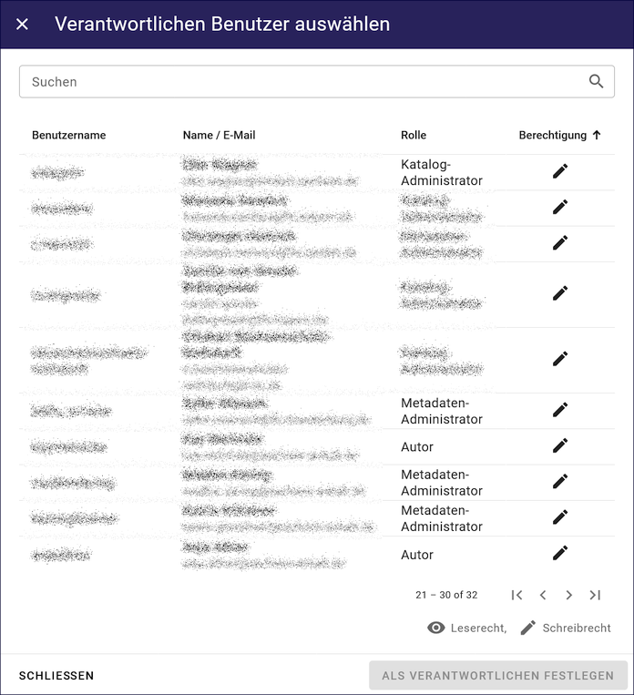

Abb.: Auswahl Verantwortung für den Metadatensatz

Nachdem ein neuer Metadatensatz erstellt wurde, wird automatisch die Person als verantwortlich eingetragen, die den Metadatensatz erstellt hat. In der Regel ist der Erfasser auch die fachlich verantwortliche Person (Standardeinstellung). Die Person, die für die Aktualisierung der Metadaten zuständig ist, sollte als Verantwortliche eingetragen werden.

Berechtigungen anzeigen
"""""""""""""""""""""""

(nur für Administrator sichtbar)

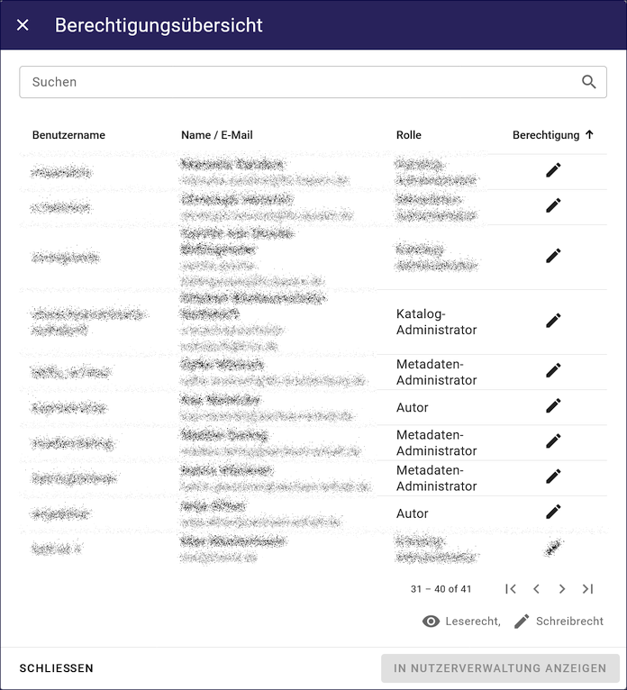

Abb.: Berechtigungen anzeigen

Schalter "Alle"-Felder ein-/ausblenden
~~~~~~~~~~~~~~~~~~~~~~~~~~~~~~~~~~~~~~

Über den Schalter |schalter-alle|, oben rechts im grauen Bereich oberhalb der Erfassungsmaske, können optionale Felder ein- oder ausgeblendet werden.

Je nach gewähltem Datensatztyp werden in der Erfassungsmaske des Editors verschiedene Felder angezeigt. Die Pflichtfelder sind abhängig von dem jeweiligen Datensatztyp und variieren dementsprechend. 

.. hint:: Grundsätzlich empfehlen wir, nicht nur die Pflichtfelder auszufüllen, sondern soweit möglich die optionalen Felder mit Einträgen zu befüllen. 

Eingabemaske
------------

Die Eingabemaske ist sehr umfangreich. Es wird zwischen Pflichtfeldern und optionalen Feldern unterschieden. Ohne die Befüllung der Pflichtfelder ist das Abspeichern des Datensatzes nicht möglich. Pflichtfelder sind durch ein Sternchen gekennzeichnet. 

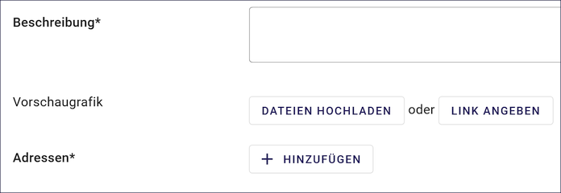

Abb.: Eingabefelder mit * sind Pflichtfelder

Feldtypen
^^^^^^^^^

**Textfelder**

Zum Füllen von Textfeldern klicken Sie in das Feld. Zum Vergrößern des Feldes, ziehen Sie mit der Maus an der rechten unteren Ecke (linke Maustaste gedrückt halten).

Abb.:  Feldtyp - Textfeld

**Datumsangaben**

Der Kalender lässt sich über das Kalendersymbol auf der rechten Seite des Feldes öffnen.

**Auswahllisten**

Auswahl-Listen können über den Pfeil auf der rechten Seite des Feldes aufgeklappt werden. Das "Autocomplete"-Feature zeigt Vorschläge während der Eingabe an.

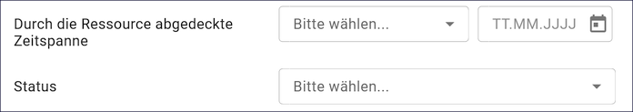

Abb.: Feldtyp - Auswahllisten und Datumsangabe

Speichern & Veröffentlichen
---------------------------

Im Editor gibt es zwei Speicheroptionen: "Speichern" speichert den bearbeiteten oder neu erstellten Datensatz, aber die Daten werden noch nicht im Internet veröffentlicht. Sie bleiben nur in der Ordnerstruktur des Editors sichtbar. Das Speichern ist jederzeit möglich, auch wenn alle Pflichtfelder noch nicht ausgefüllt wurden.

Abb.: Speichern

Mit dem abschließenden "Veröffentlichen" werden die Daten für das Internet freigegeben. Zuvor erfolgt eine Prüfung auf Vollständigkeit und Korrektheit der Einträge.

Abb.: Veröffentlichen

Um den Vorgang "Veröffentlichen" zu ermöglichen, müssen alle Pflichtfelder ausgefüllt werden. Fehlen notwendige Angaben, erscheint beim Betätigen des Buttons "Veröffentlichen" eine Fehlermeldung und die Überschriften der fehlenden Felder werden rot angezeigt. 

Abb.: Hinweis - Alle Pflichtfelder ausfüllen

Um trotz der Fehlermeldung die Bearbeitung zu sichern, wählen Sie die Funktion "Speichern".

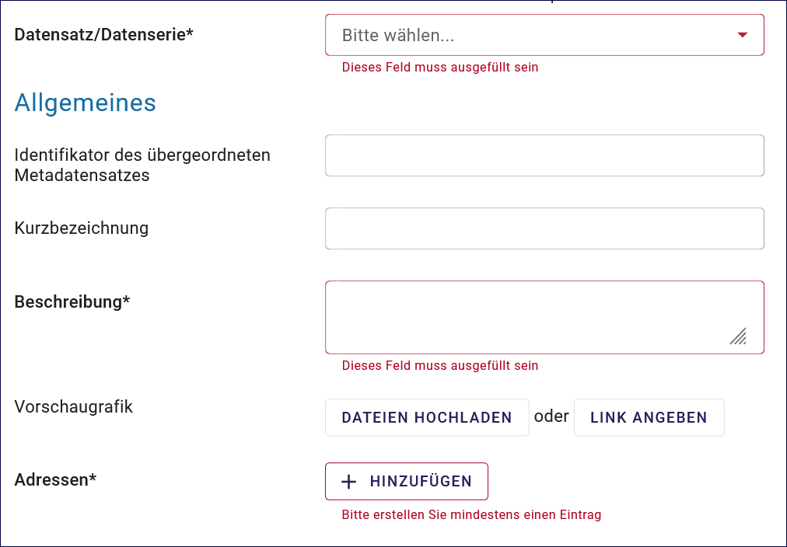

Abb.: Hinweis am Feld - Dieses Feld muss ausgefüllt sein

Felder, die nicht korrekt ausgefüllt sind, werden mit der Anmerkung "Es wird mindestens ein Eintrag erwartet" gekennzeichnet.

Optionen für die Veröffentlichung
---------------------------------
   
Rechts neben VERÖFFENTLICHEN befindet sich der Button für verschiedene Optionen (Pfeil nach unten).

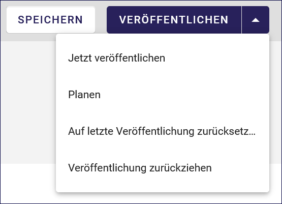

Abb.: Fenster mit Optionen für die Veröffentlichung
   

Option: "Jetzt veröffentlichen"
^^^^^^^^^^^^^^^^^^^^^^^^^^^^^^^

Der Button "Veröffentlichen" und die Option "Jetzt veröffentlichen" haben dieselbe Funktionalität.

Abb.: Dialogfenster - Auswahl für Veröffentlichungsvarianten

Abb.: Meldung: Das Dokument wurde veröffentlicht

Option: "Veröffentlichung planen"
^^^^^^^^^^^^^^^^^^^^^^^^^^^^^^^^^

Die Veröffentlichung von Datensätzen kann geplant werden. Nach der Validierung wird beim Veröffentlichen das Dialogfenster "Veröffentlichen" angezeigt, in dem das zukünftige Veröffentlichungsdatum "VERÖFFENTLICHUNG PLANEN" ausgewählt werden kann. Im Anschluss öffnet sich ein weiteres Fenster mit der Kalenderfunktion "Veröffentlichen planen", in dem das Veröffentlichungsdatum gewählt werden kann.

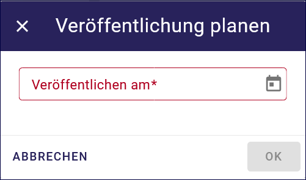

Abb.: Dialogfenster - Auswahl für Veröffentlichungsdatum

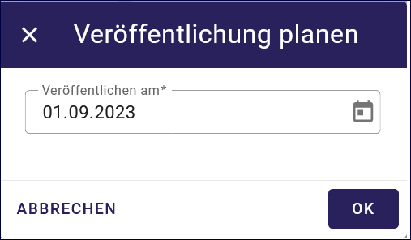

Abb.: Funktion Veröffentlichung planen - Angabe eines Datums

Das Veröffentlichungsdatum wird anschließend im Kopfbereich des Datensatzes angezeigt.

Abb.: Kopfbereich der Eingabemaske - Anzeige des Veröffentlichungsdatums

Die Planung der Veröffentlichung kann abgebrochen werden. Unterhalb des Veröffentlichungsdatums befindet sich ein Button mit der Beschriftung "Veröffentlichung abbrechen und Datensatz bearbeiten". Nach dem Klick darauf erscheint ein grünes Feld mit der Meldung: "Die geplante Veröffentlichung wurde abgebrochen".

Abb.: Meldung für die geplante Veröffentlichung

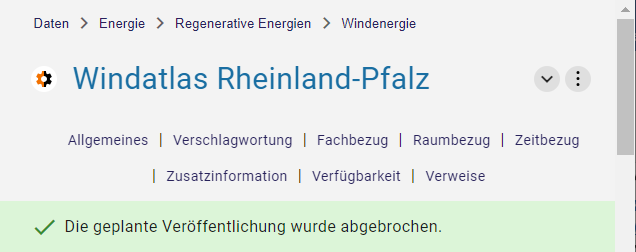

Abb.: Meldung für: VERÖFFENTLICHUNG ABBRECHEN UND DATENSATZ BEARBEITEN

Option: "Auf letzte Veröffentlichung zurücksetzten"
^^^^^^^^^^^^^^^^^^^^^^^^^^^^^^^^^^^^^^^^^^^^^^^^^^^

Wenn ein Metadatensatz veröffentlicht und danach geändert und gespeichert wurde (Symbol orange/schwarz), kann die Änderung über die Funktion "Auf letzte Veröffentlichung zurücksetzen" (Symbol schwarz) rückgängig gemacht werden.

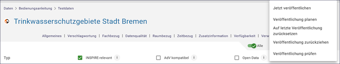

Abb.: Auf letzte Veröffentlichung zurücksetzen

Option: "Veröffentlichung zurückziehen"
^^^^^^^^^^^^^^^^^^^^^^^^^^^^^^^^^^^^^^^

Veröffentlichte Datensätze können aus der Veröffentlichung zurückgezogen werden. Auf diese Weise können Metadaten eingezogen werden, zu Diensten, die deaktiviert wurden bzw. Datensätzen, die aus dem Vertrieb herausgenommen wurden.

Abb.: Abfrage, ob die Veröffentlichung wirklich zurückgezogen werden soll

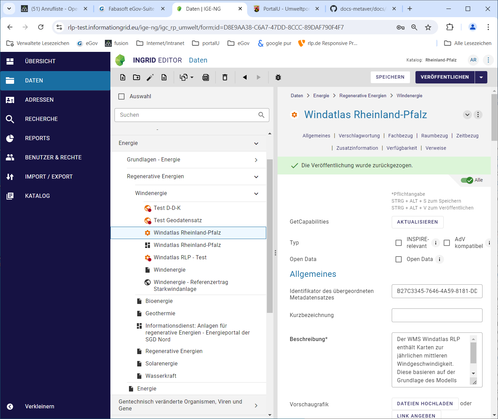

Abb.: Die Veröffentlichung für diesen Datensatz wurde zurückgezogen.

Der getCapabilities-Assistent
-----------------------------

Abb.: Symbolleiste -  getCapabilities-Assistent

Für die Erfassung von Geodatendiensten (WMS, WFS, WCS, WCTS, WMTS und CSW) eignet sich die Funktion "getCapabilities-Assistent". Der Assistent wird über die Symbolleiste aufgerufen. In dem sich öffnenden Fenster muss die getCapabilities-URL eingetragen werden. Nachdem der Button "ÜBERNEHMEN" betätigt wurde, werden die Operationen im Hintergrund verarbeitet, wodurch die Erfassung von OGC-konformen Diensten erheblich vereinfacht wird. Die Analyseergebnisse werden angezeigt und es besteht die Möglichkeit, auszuwählen, welche Metadaten in den Metadatensatz übernommen werden sollen. Danach kann der Datensatz im Editor weiter bearbeitet und gespeichert werden.

Eine ausführliche Beschreibung für diese Funktion erfolgt im Datensatztyp `Geodatendienst <./de/latest/ingrid-editor/erfassung/datensatztypen/datensatztyp-geodatendienst.html>`_.

Metadaten anzeigen
------------------

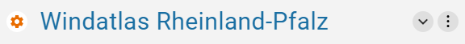

Abb.: Metadaten - Menü für Metainformationen anzeigen

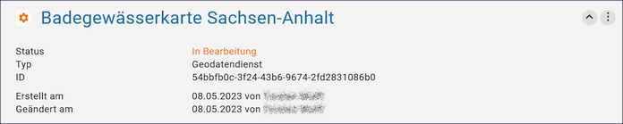

Abb.: Metadaten - Metainformationen  - Metadaten

Ordner/Metadaten verschieben
----------------------------

Wenn ein Ordner oder ein Metadatensatz in der Ordnerstruktur angeklickt wird, während die Steuerungstaste (STRG) gedrückt wird, erscheinen Kontrollkästchen vor den jeweiligen Ordnern oder Metadaten. Der Ordner oder Metadatensatz kann dann mit einem Haken markiert werden und durch Ziehen mit der linken Maustaste innerhalb der Ordnerstruktur verschoben werden. 

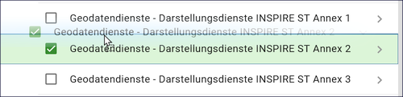

Abb.: Auswahl - per Drag and Drop verschieben

Die markierten Ordner und Metadaten können auch über das Symbol in der Symbolleiste verschoben oder kopiert werden.

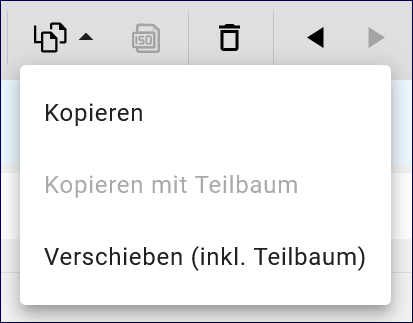

Abb.: Verschieben / Kopieren

Dies funktioniert auch mit aktiviertem Kontrollkästchen "Auswahl" unterhalb der Symbolleiste. Dann erscheinen Kontrollkästchen für die Auswahl vor den Ordnern und Metadaten. 

Abb.: Kontrollkästchen "Auswahl"

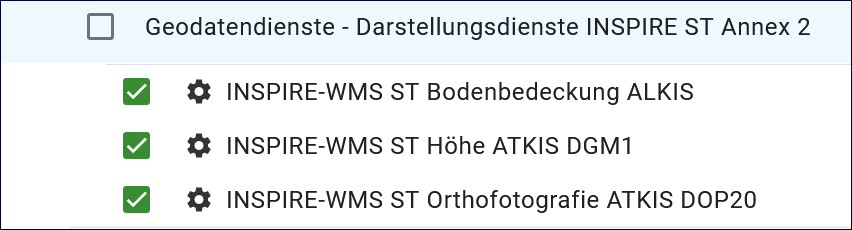

Abb.: Auswahl - Kontrollkästchen

Bei aktiviertem Kontrollkästchen "Auswahl" erscheint das Wort "Alle". Wenn hier ein Haken gesetzt wird, werden alle Ordner und Metadaten mit einem Haken im Kontrollkästchen versehen.

Abb.: Auswahl - Kontrollkästchen  für "Alle"

Zur Beendigung der Auswahl muss das Kreuz im Kontrollkästchen unterhalb der Symbolleiste angeklickt werden.

Abb.: Auswahl - Beenden

Besuchszeit ist abgelaufen (Logout)
-----------------------------------

Wenn der Editor für eine längere Zeit (30 Minuten) nicht genutzt wird, läuft die Besuchszeit ab. 5 Minuten vor Ablauf der Besuchszeit erscheint oben auf der Seite ein Countdown. Ist der Countdown angelaufen wird der Benutzer aus dem Editor abgemeldet und muss sich neu anmelden. Der "Refresh-Button" kann optional betätigt werden, um den Countdown neu zu starten. 

.. hint:: Wenn Sie aus dem Editor ausgeloggt wurden, laden Sie die Login-Seite neu (Taste F5), sonst erhalten Sie bei einem erneuten Login-Versuch die Meldung: „Sie haben zu lange gebraucht, um sich anzumelden. Bitte versuchen Sie es erneut.“

Abb.: Countdown für den Logout und "Session-refresh-Button"

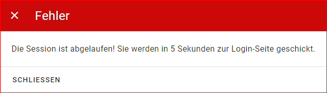

Abb.: Meldung - Besuchszeit abgelaufen

Leider gehen alle Änderungen und Neueingaben verloren, die bis zu diesem Zeitpunkt nicht gespeichert wurden. Es erfolgt keine automatische Zwischenspeicherung! Daher empfiehlt es sich, während der Erfassung von Verfahren und Adressen regelmäßig zu speichern. Eine automatische Zwischenspeicherung ist zukünftig vorgesehen.

Editor schließen
----------------

Soll der Editor beendet werden, müssen Sie auf der Seite oben rechts den Punkt für die Profilverwaltung anklicken

Abb.: Profilverwaltung mit Button "ABMELDEN"
